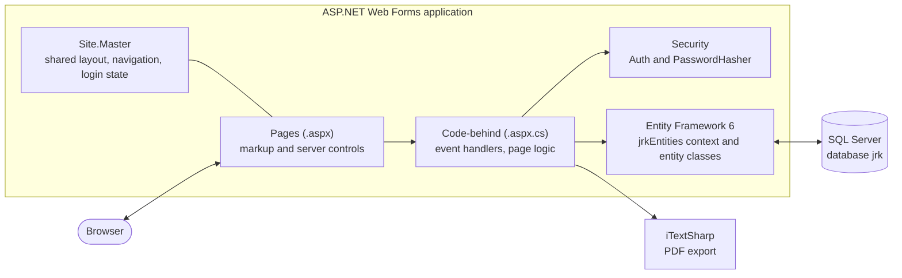
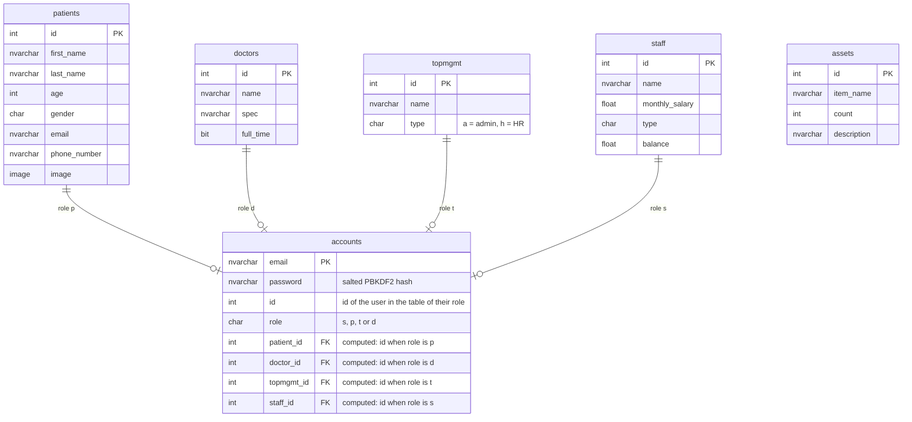

# Hospital Management System


A web application for running a small hospital: a public website, patient registration, and an
administration dashboard for doctors, patients, managers, equipment and user accounts. Built with
ASP.NET Web Forms, Entity Framework and SQL Server.

> **Educational project.** This was built as coursework for a web programming course, to practise
> a complete multi-role, database-backed web application. It was never deployed or used with real
> patients, and all data in the repository is fictional.

## Table of contents

- [Features](#features)
- [User roles](#user-roles)
- [Tech stack](#tech-stack)
- [Architecture](#architecture)
- [Database](#database)
- [Project structure](#project-structure)
- [Getting started](#getting-started)
- [Demo accounts](#demo-accounts)
- [Security](#security)
- [What this project demonstrates](#what-this-project-demonstrates)
- [Scope](#scope)
- [License](#license)

## Features

**Public website**
- Landing page with the hospital's services, doctors and a patient reviews slider
- Live counters of doctors and patients, read from the database

**Accounts**
- Login with email, password and role, then redirection to the home page of that role
- Passwords stored as salted hashes, and every page restricted to the role it belongs to
- Patient self-registration with a profile photo
- Form validation on both sides of the form: required fields, email format, phone format,
  minimum password length, duplicate email check
- Logout, and a navigation bar that adapts to the logged-in user

**Administration dashboard**
- One screen to browse five data sets: doctors, patients, managers, assets and accounts
- **Search and filter**: doctors by name, specialty or full-time status; patients by first name,
  last name, gender, email, phone number or age range
- **Create**: doctors and HR managers together with their login account, and assets
- **Update**: doctors, patients and managers
- **Delete** with a confirmation page; the linked login account is removed with the record,
  which the database also guarantees with foreign keys
- **Export to PDF** of the table currently displayed

**Patient portal**
- Profile page with the patient's photo
- Upload, replace or delete the photo; images are validated by type and stored in the database

## User roles

| Role | Signs in as | Can do |
|---|---|---|
| Top management | Admin | Everything in the administration dashboard |
| Patient | Patient | Register, sign in, manage their profile photo |
| Doctor | Doctor | Sign in; the doctor home page is a placeholder |
| Staff | Employee | Sign in; the staff home page is a placeholder |

## Tech stack

| Layer | Technology |
|---|---|
| Language and runtime | C#, .NET Framework 4.7.2 |
| Web framework | ASP.NET Web Forms: master page, server controls, code-behind, validation controls |
| Data access | Entity Framework 6, database-first (EDMX), LINQ to Entities |
| Database | Microsoft SQL Server (Express) |
| PDF export | iTextSharp 5 |
| Front end | Bootstrap 5, Font Awesome 6, Swiper, custom CSS |
| IDE | Visual Studio 2022 |

## Architecture



- **`Site.Master`** holds the layout shared by every page: navigation bar, footer, and the
  login / logout links, which change with the logged-in user.
- Each **page** is an `.aspx` file for the markup and an `.aspx.cs` code-behind file for its event
  handlers.
- The code-behind talks to the database through **Entity Framework**. The entity classes
  (`doctor`, `patient`, `account`, …) and the `jrkEntities` context are generated from the
  database schema (`Model1.edmx`), and queries are written in LINQ.
- The **`Security`** folder holds the two classes every page relies on: `Auth`, which keeps the
  logged-in user's id and role in the server-side session and checks the role at the top of each
  page, and `PasswordHasher`, which hashes and verifies passwords.

## Database



`accounts` is the single login table. Its `role` column says which table the user belongs to and
its `id` column is the user's id in that table.

A single column cannot reference four tables, so the link is enforced with one **persisted
computed column per role** (`patient_id`, `doctor_id`, `topmgmt_id`, `staff_id`), each holding the
id only when the account has that role and each carrying a **foreign key** with
`ON DELETE CASCADE`. The database therefore rejects an account that points to a user who does not
exist, removes the account when its user is deleted, and a `UNIQUE (role, id)` constraint allows
at most one account per user. The Entity Framework model is unchanged, because these columns are
filled in by SQL Server.

Other data rules, such as valid roles, non-negative ages and salaries, and email and phone
formats, are enforced with `CHECK` constraints.

The full script, with demo data, is in [`database/schema.sql`](database/schema.sql).

## Project structure

```
hospital-management-system/
├── HospitalManagementSystem.sln
├── HospitalManagementSystem/              # the web application project
│   ├── Site.Master                        # shared layout
│   ├── Home.aspx                          # public landing page
│   ├── login.aspx, usersignup.aspx        # authentication
│   ├── adminHomePage.aspx                 # administration dashboard
│   ├── adminAdd*.aspx                     # create doctor, manager, asset
│   ├── adminEdits*.aspx                   # update doctor, patient, manager, asset
│   ├── adminDelete*.aspx                  # delete confirmations
│   ├── patientHomePage.aspx               # patient profile
│   ├── patientEditImage.aspx, imageDeletion.aspx
│   ├── doctorHomePage.aspx, staffHomePage.aspx
│   ├── Security/
│   │   ├── Auth.cs                        # session login state and role check
│   │   └── PasswordHasher.cs              # PBKDF2 password hashing
│   ├── Model1.edmx                        # Entity Framework model (database-first)
│   ├── account.cs, doctor.cs, patient.cs, …   # generated entity classes
│   ├── Content/                           # css, images, media, vendor libraries
│   ├── Scripts/                           # JavaScript
│   ├── Uploads/                           # uploaded profile photos (ignored by git)
│   ├── Web.config                         # configuration and connection string
│   └── packages.config                    # NuGet dependencies
├── database/
│   └── schema.sql                         # tables, foreign keys, constraints and demo data
├── LICENSE
└── README.md
```

Every `.aspx` page comes with its `.aspx.cs` code-behind and its generated `.aspx.designer.cs`.

## Getting started

**Requirements**

- Windows with Visual Studio 2019 or 2022, with the *ASP.NET and web development* workload
- .NET Framework 4.7.2 developer pack
- SQL Server Express

**1. Create the database.** Open `database/schema.sql` in SQL Server Management Studio and run it,
or from a terminal:

```
sqlcmd -S .\SQLEXPRESS -i database\schema.sql
```

If a database named `jrk` already exists from an earlier version, drop it first; the script
creates it from scratch.

**2. Check the connection string.** `HospitalManagementSystem/Web.config` points to a local
instance named `.\SQLEXPRESS` with Windows authentication. If your instance has another name,
change the `data source` value:

```
data source=.\SQLEXPRESS;initial catalog=jrk;integrated security=True
```

**3. Open and run.** Open `HospitalManagementSystem.sln` in Visual Studio. The NuGet packages are
restored on the first build. Set `Home.aspx` as the start page (right-click the file) and press
**F5**.

## Demo accounts

Created by `database/schema.sql`. On the login page, choose the role in the *Sign in as* list.

| Role to select | Email | Password |
|---|---|---|
| Admin | `Kareem@topmgmt.com` | `AdminP@ssw0rd` |
| Admin (HR manager) | `Jalal@topmgmt.com` | `HighP@ssw0rd` |
| Patient | `adam.haddad@example.com` | `SecureP@ssw0rd` |
| Doctor | `randomemail<id>@example.com` | `StrongP@ssw0rd` |
| Employee | `John@staff.com` | `StaffP@ssw0rd` |

Fifteen doctors, chosen at random by the script, receive an account. Their emails are listed in
the *Accounts* view of the administration dashboard. The database stores only the hashes of these
passwords.

## Security

- **Password hashing.** Passwords are never stored. `PasswordHasher` derives a key with PBKDF2
  (HMAC-SHA256, 100,000 iterations) and a random 16-byte salt per password, and compares hashes
  in constant time at login. The *Accounts* view and its PDF export leave the hashes out.
- **Server-side login state.** After login the user's id and role are kept in the ASP.NET session
  on the server. The browser only holds the session id, in an `HttpOnly` cookie, so a user cannot
  change their own id or role. Logging out clears the session.
- **Authorization on every page.** Each page calls `Auth.RequireRole(...)` first: the
  administration pages require top management, the profile pages require a patient, and so on.
  Visitors who are not logged in are sent to the login page, and users of another role to their
  own home page, before any page logic or button handler runs.
- **Users act on their own data.** The patient pages take the patient id from the session, never
  from the request.
- **Referential integrity** in the database, described in [Database](#database).
- **Output encoding.** Names typed by users are HTML-encoded before they are written into the
  navigation bar and the confirmation pages.
- **No SQL injection surface.** All queries go through LINQ to Entities, which sends parameters.

## What this project demonstrates

- **A complete multi-role application**: four kinds of users, one login table, role-based
  navigation, redirection and access control.
- **Security fundamentals**: salted password hashing, server-side sessions and a role
  check on every page.
- **Full CRUD** over several related tables, with confirmation steps for deletions and cleanup of
  the linked account.
- **Database design**: identity keys, foreign keys for a one-table-per-role link, `CHECK`
  constraints for business rules, and a seeding script that generates randomized demo data in
  T-SQL.
- **Entity Framework database-first** with LINQ queries, including multi-criteria search and a
  range filter.
- **Web Forms fundamentals**: master pages, server controls, `GridView` data binding, postbacks,
  validation controls with regular expressions, sessions and cookies.
- **File handling**: image upload with type validation, binary storage in the database, and
  rendering from bytes with content-type detection.
- **Reporting**: export of the displayed data to PDF.

## Scope

This is a learning project, and its scope is the scope of a course assignment:

- The doctor and staff areas are placeholder pages, and the asset edit page only displays the
  record.
- The site is meant to run locally over HTTP. A deployment would add HTTPS, secure cookies,
  account lockout after repeated failed logins and a password reset flow.
- There are no automated tests.
- ASP.NET Web Forms is a legacy framework; a new project would use ASP.NET Core with ASP.NET
  Identity.

## License

The code is released under the [MIT License](LICENSE). Third-party components keep their own
licenses: Bootstrap (MIT), Font Awesome Free, Swiper (MIT) and iTextSharp 5 (AGPL). The photos on
the landing page are stock images used for demonstration only.
